# MoE 推理系统研究：问题、算法与下一步研究机会

## 0. MoE 推理研究现状：共同问题在哪里？

### 0.1 一层 MoE 到底执行了什么？

以一个已经完成 Attention 的 Token `x` 为例，MoE 层并非让所有 FFN 都计算，而是：

1. **Router** 根据 `x` 计算所有专家的 Gate Logits，选出 Top-K 个**逻辑专家**。它决定“这个 Token 由谁计算”，不是决定物理 GPU。
2. **Physical Dispatch** 根据专家的物理放置和副本分配表，把 Token 发给拥有相应专家权重的 GPU。每个 Token 通常向 K 个专家各发送一次。
3. **Grouped GEMM / Expert FFN** 把发往同一专家的 Token 打包，运行不同形状的专家矩阵乘法。
4. **Combine** 把各 Expert 输出传回原 Token 所在的设备，按照 Gate 权重合并，并恢复 Token 顺序。
5. **下一层** 继续执行。**该层整体耗时往往由最慢 Rank 和通信同步决定**。

不同并行方式的区别也必须先明确：在 **EP** 中，一个逻辑 Expert 通常有完整权重副本分布到指定设备，Token 通过 All-to-All 到达它；在 **TP-only** 中，专家矩阵可能按张量维度切分，并不必然使用相同的专家 Dispatch/Combine 流程。下面四篇主要讨论具有物理专家放置及冗余副本选择自由度的 EP。

### 0.2 Prefill 和 Decode 为什么是两套性能问题？

| 维度 | Prefill | Decode |
|---|---|---|
| 输入 Token | 较多 Token 同时进入 MoE | 每步通常每个活跃请求仅一个新 Token |
| 专家 GEMM | 更容易有较大的 M，计算更充分 | 小 M、权重装载与 Launch/同步常占比更大 |
| Dispatch / Combine | 关注大规模传输、吞吐和流水线 | 关注每轮的固定延迟与等待时间 |
| 热点变化 | Batch/序列长度导致专家偏斜 | 每一层、每一 Step 都可能变化 |
| 调度成本 | 可能有更多计算时间掩蔽规划开销 | 规划器可能比希望节省的时间还慢 |
| 核心指标 | TTFT、Prefill Tokens/s | TPOT、P95/P99 ITL、Decode Tokens/s |

这意味着一个在大 Batch 上很好的 Load Balancer，迁移到 Decode 不一定有收益；一个很快的 All-to-All Kernel，也不能保证它的后续 Expert GEMM 没有 Straggler。

### 0.3 目前公认的五个矛盾

**矛盾一：逻辑专家负载本来就不均匀。** 模型 Router 对不同 Expert 有不同偏好，简单地强迫逻辑 Top-K 均匀可能破坏模型行为。系统要做的是在不改变 Router 结果的前提下改动物理执行。

**矛盾二：Token 数相同，不代表 GPU 耗时相同。** 小专家可能被读取权重的固定开销主导；热专家可能被计算主导；M-Tile Padding 又让计算时间呈阶梯状。

**矛盾三：更好的分配需要更多计算时间。** 如果优化 LP 花费约 100 μs，而单层 MoE 只有几十微秒，就可能得不偿失。

**矛盾四：搬 Token 和搬 Expert Weight 谁更便宜？** 已有副本可低成本重分 Token；没有副本时可以复制专家权重，但参数搬运、显存和同步不是免费的。

**矛盾五：时间能否被重叠隐藏？** `Dispatch + GEMM + Combine` 是逻辑顺序，但真实系统可以把一部分数据传输和计算流水重叠，因此总时延应看 Dependency Critical Path，而非简单把三项相加。

可以把研究空间粗略分成：

| 决策 | 作用 | 代表工作 |
|---|---|---|
| **Expert Placement** | 决定专家/副本在哪些 GPU | EPLB、CRAFT |
| **Token-to-Replica Split** | 决定现有副本各接多少 Token | LPLB、TEMPO、Relief |
| **Dynamic Replication** | 当前 Step 为热点专家创建新副本 | LLEP、MegaFlux、UltraEP |
| **Communication Protocol** | 决定如何传输与同步 | DeepEP、NVLinkOneSided |
| **Execution Strategy** | 决定是否融合、如何重叠与流水 | MegaFlux、OverlapAdvisor |

**研究趋势**：2025–2026 年，问题正在从“尽量均匀分 Token”演进为“让当前 MoE 层的真实执行关键路径尽可能短”。下文四篇分别解决**成本目标、求解速度、复制执行、策略选择**这四个环节。

---

## 1. TEMPO：先搞清楚「什么叫负载均衡」

**论文**：[TEMPO: Makespan-Aware Expert-Parallel Load Balancing Across Memory- and Compute-Bound Regimes](https://arxiv.org/abs/2608.13057) · [PDF](https://arxiv.org/pdf/2608.13057)  
**作者**：Jie Li、Chenxin Jia、Jinliang Shen、Cunzhuang Liu 等；Chengru Song 为通讯作者。  
**机构**：KlingAI Research。**代码**：论文提到的 [TEMPO 仓库](https://github.com/jeshxxx/TEMPO)，公开可用性尚未确认。

### 1.1 研究背景与问题定义：均衡 Token 为什么还会拖尾？

传统 EP 的一个简单基线是将同一逻辑专家的 Token 分给不同物理副本，让各 GPU 接收的 Token 总数尽量接近。问题是 Grouped GEMM 的实际耗时不仅取决于 Token 数，还取决于被激活的专家副本数量、读入的专家权重以及 Tile Padding。

**TEMPO 研究的不是如何改变模型 Router，而是：保持 Top-K 专家不变、已有专家副本位置不变，怎样决定每个副本执行多少 Token，才能减少最慢 GPU 的真实执行时间？**

该问题在冷专家与热专家混合的 Decode Batch 中尤其突出：冷专家可能每次都需要支付读权重的固定成本，热专家的 GEMM 才可能随 Token 数显著增长。

### 1.2 核心算法：输入、输出与基本机制

**一句话：TEMPO 不追求每张 GPU 分到同样多的 Token，而是预测每张 GPU 处理这些 Token 需要多长时间，再最小化最慢 GPU 的耗时。**

输入是某层当前各逻辑专家收到的 Token 数 `n[e]` 和已经存在的专家副本位置；输出是每个专家在各合法 GPU 上的 Token Split。

令 `x[e,g]` 表示专家 `e` 在 GPU `g` 上执行的 Token 数：

```text
约束 1：对任意专家 e，sum_g x[e,g] = n[e]
约束 2：只有 GPU g 存在专家 e 的物理副本时，x[e,g] 才能 > 0
目标：minimize max_g PredictedTime(g, x)
```

这和传统 LPLB 主要最小化每卡 Token 数的最大值相比，改变的是**优化目标函数**。

### 1.3 核心 Insight：为什么旧方法在这里失效

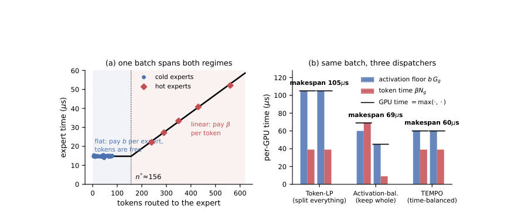

**图 1｜Token 分得一样多，不代表 GPU 用时一样长。** 左图：单个专家的 Token 较少时，执行时间几乎不变；超过约 156 个 Token 后，时间才随计算量明显增长。右图：针对同一批请求，按 Token 数平分的方案反而比 TEMPO 的时间感知分配更慢。

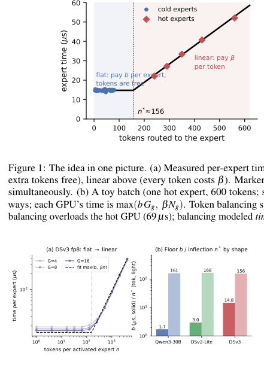

**图 2｜专家计算存在“固定开销区”和“计算增长区”。** 左图：每个专家的执行时间先接近水平线，Token 足够多后才上升。右图：不同模型形状的转折点并不相同，所以调度器需要针对模型和 GPU 测量成本，不能使用一个通用的 Token 阈值。

**为什么？** 每激活一个物理 Expert，就可能要从 HBM 读一次权重。冷专家仅有少量 Token 时，多复制一个执行位置通常意味着多支付一份固定读权重开销；热专家有大量 Token 时，更可能受 GEMM 计算量约束。

TEMPO 把每个 GPU 的估计时间近似写成：

$$
\widehat{T}_g = \max(a+bG_g,\;c+\beta N_g).
$$

- `G_g`：GPU `g` 本步激活的物理专家副本数；
- `N_g`：它需要处理的 Token 总数；
- `a+bG_g`：更多地反映 Weight Streaming / 启动地板；
- `c+βN_g`：更多地反映计算主导的部分。

**直白例子**：一个冷专家只有 10 个 Token，却有 GPU0/GPU1 两份权重。如果全放 GPU0，本次只激活一份；若为了“均匀”平分为 5+5，两个 GPU 都必须读取这个专家的权重。看起来 Token 更平衡，实际执行可能更慢。反之，600 个 Token 的热专家分给两卡，可能显著降低 GEMM 拖尾。

### 1.4 算法如何对应问题：逐步解决什么

TEMPO 的处理分为几个阶段：

1. **离线测量**：在目标硬件、量化、Grouped GEMM Kernel 和 Token Shape 下标定执行时间，拟合上面的混合成本模型以及 Tile Padding 修正。
2. **先整体分配 Expert**：用贪心方案把专家 Token 尽量放到边际成本低的物理副本，避免过早把大量冷专家拆得很碎。
3. **改善冷专家区间**：通过增广链调整专家执行位置，降低不必要的激活副本数。
4. **改善热专家区间**：对瓶颈 GPU 上的热专家做局部搬移或部分 Split，降低最大的预测完成时间。
5. **比较安全候选**：把调度结果同简单 Token LP 等基线按同一预测模型评价，优势不明显时可以保持原方案。

```python
# 教学伪代码，并非 TEMPO 作者源码
cost = calibrate_real_grouped_gemm()
assignment = greedy_whole_expert_placement(expert_counts, replicas)
assignment = reduce_unnecessary_activated_replicas(assignment, cost)
assignment = split_hot_experts_on_bottleneck_gpus(assignment, cost)
publish_assignment_async(assignment)
```

特别注意 **Async**：TEMPO 把部分求解工作放在后台，利用近期负载统计更新 Dispatch Table，执行侧读最新的表。这减少求解器对当前 GPU Critical Path 的影响，但表可能落后于正在发生的路由变化。

### 1.5 实验结果：成本模型在哪些场景真正有用？

**实验设置。** 论文使用两代数据中心 GPU（具体型号匿名），在 EP8 上进行实机微基准和 SGLang 端到端测试，并将成本模型扩展至 EP32–64 的模拟实验。端到端主要比较 Qwen3-235B-A22B-FP8 和 DeepSeek-V3，基线包括静态 EPLB、均匀副本分配和 Token-LP。

**（1）负载不同时，正确的均衡方式也不同。**

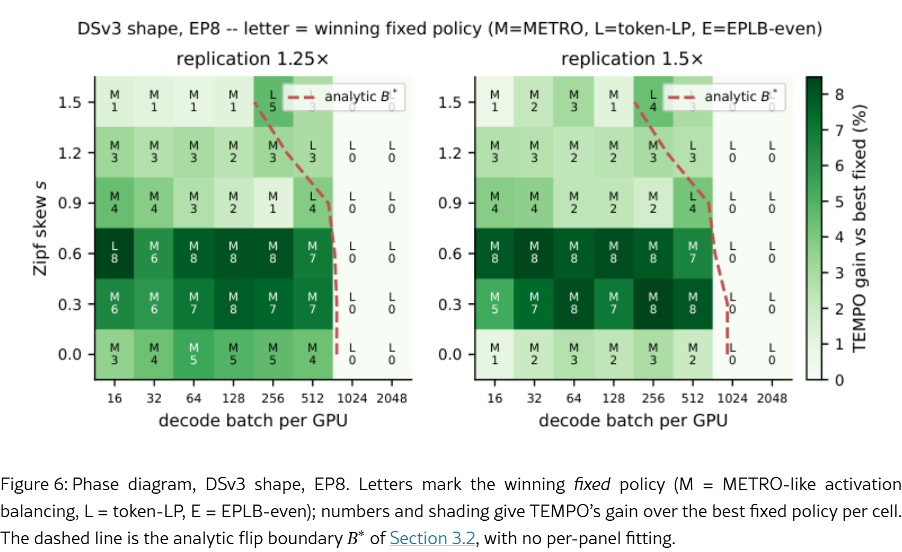

**原论文 Figure 6｜不同负载下的性能相图。** 横轴与纵轴分别描述 Batch 大小和专家路由偏斜程度；字母标记当前条件下最好的固定策略，颜色与数字表示 TEMPO 相对该策略的收益。小 Batch 更适合减少被激活的专家副本，大 Batch 更适合分担 Token 计算，混合区间则需要同时考虑二者。作者报告 TEMPO 在模拟网格上与最佳固定策略的差距不超过 1%，部分混合区间收益最高达 15.5%（最大收益包含 EP32–64 的模型外推，并非全规模实机结果）。

**（2）端到端验证：同一算法在不同模型上可以一赢一输。**


**原论文 Figure 8｜真实服务吞吐与 P99 TPOT。** 图中以同一测量窗口的静态策略为参照，比较多种分配方法。Qwen3-235B 在长文档摘要等负载有收益，而 DeepSeek-V3 在通信占主导的设置下没有收益。

| 场景 | TEMPO 相对静态策略的结果 |
|---|---|
| Qwen3-235B，GovReport | 吞吐中位数提升约 5% |
| Qwen3-235B，Poisson 到达（8 请求/s） | P99 TPOT 从 226 ms 降至 191 ms（−15.6%） |
| Qwen3-235B，双节点 EP16 | 拓扑感知分配在相关负载下提升约 4–7% |
| DeepSeek-V3，通信占主导 | 各负载吞吐下降约 2–3% |

**结论。** TEMPO 最有价值的结果并非最大加速比，而是证明负载均衡存在明确的适用区间。真实耗时模型能够解释不同策略何时有效，也能预测什么时候不该增加调度开销。论文还发现，相对原版 LPLB 的部分大幅收益来自移除逐层通信和调度开销，不能全部归功于成本目标函数。

### 1.6 现有局限与值得进一步研究的问题

**作者说明**：成本模型依赖硬件与 Kernel 标定；仅用 `G` 和 `N` 尚未完整刻画专家 Slot 分布；后端异步更新导致 Routing Table 陈旧；在通信占优的工作负载上未必有收益；多节点更复杂的网络成本仍需建模。

**我的研究判断**：TEMPO 改善了“决策目标”，但没有真正实现**当前 Step、低开销、成本感知**的在线精细分配。

**潜在创新**：设计一种 Staleness-aware Dispatcher：根据专家热点变化速度决定继续用后台表、在本步快速修正，或者直接回退到简单规则。需要比较“预测准确率”之外的真实 TPOT / Planner Overhead / P99。

---

## 2. Relief：让负载均衡算法快到能在每个 Decode Step 都运行

**论文**：[A Per-Step Load-Balancing Engine for Expert-Parallel MoE Serving](https://arxiv.org/abs/2611.11402) · [PDF](https://arxiv.org/pdf/2611.11402)  
**作者**：Jingyuan Li、Maolin Wang、Hayden So。**机构**：HKU / HKUST。  
**代码**：[relief-paper-archive](https://github.com/SuanNaiShuiGuoLao/relief-paper-archive) 是论文档案，尚不能当作完整可运行的 EP 求解器。

### 2.1 研究背景与问题定义：每步负载变化，求解器却比推理还慢

EP 的专家复制通常不会每个 Token 都变化，但 **Router 的实际输出会随 Decode Step 改变**。如果沿用上一步的 Token-to-Replica 分配表，新的热点可能使某些 GPU 拖尾；如果每步用线性规划精确重算，又可能付出可观的求解时间。

**Relief 研究的问题**是：给定已放好的物理专家副本和当前这一步的专家 Token 计数，怎样用非常少的 GPU/硬件操作，为当前 Step 生成足够均衡的 Token 分配？这里需要连求解器本身耗时一起算。

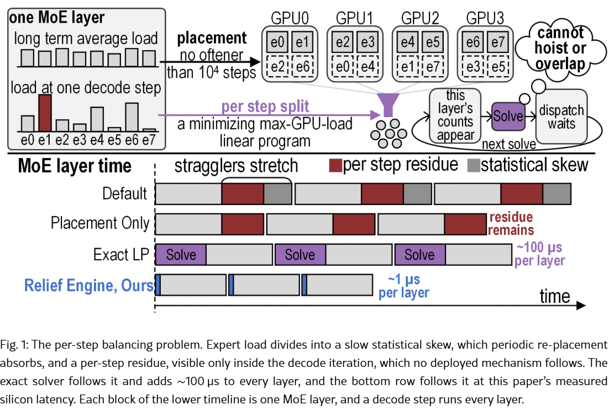

**图 3｜为什么要做“每步负载均衡”。** 图的上方显示专家放置通常经过很多步才更新，而每个 Decode Step 的专家请求量都不同；下方显示三种执行方式：完全不调整会留下大量 GPU 等待，逐步求精确最优解又需要等待求解器，Relief 则希望用更快的计算缩短这段额外等待。

### 2.2 核心算法：输入、输出与基本机制

- **顶点**：物理 GPU。
- **边**：一个逻辑专家在两个 GPU 上各有一份副本，表示二者之间可以转移该专家的 Token。
- **边上的流量**：当前专家在两个副本之间的 Token Split。
- **顶点负载**：该 GPU 所有专家 Token 之和。

假设 GPU0 负载 100，GPU1 负载 20；二者共享专家 `e`，GPU0 目前有足够多的 `e` Token 可移动。若转移 `Δ` 个 Token：

```text
GPU0: 100 → 100 - Δ
GPU1:  20 →  20 + Δ

若 Δ = (100 - 20) / 2 = 40
则两端都变为 60。
```

因此一次成对松弛的核心操作可以写成：

$$
\Delta = \min\left(\left\lfloor
\frac{|L_u-L_v|}{2}\right\rfloor,
\mathrm{MovableTokens}(e,u,v)\right).
$$

这只需要整数减法、比较、右移（折半）和更新两个计数器。下一轮其他边更新后，负载方向也可能反转，所以允许双向转移。

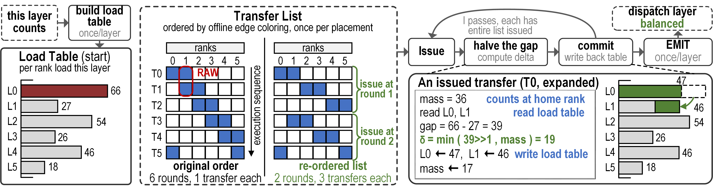

**图 4｜Relief 怎样把负载差转成可以并行执行的搬运操作。** 左边是本层各 GPU 的初始负载；中间依次列出从重载卡转到轻载卡的专家 Token 搬运计划；右边是在这些计划执行后，各 GPU 的负载更接近。不同轮次处理互不冲突的 GPU 对，减少同步冲突。

### 2.3 核心 Insight：为什么旧方法在这里失效

一个典型矛盾：

- 复用上一步分配：本步专家流量已变，GPU 可能严重不均衡；
- 本步现求 LP 最优：规划延迟可能是几十至上百微秒，吃掉 MoE 的部分收益；
- 忽略求解时间只比较“均匀程度”：优化指标错误。

Relief 因此关心一个更务实的指标：

$$
U_\text{effective}
= U_\text{spatial}\cdot
\frac{T_\text{MoE}}{T_\text{solve}+T_\text{MoE}}.
$$

如果为了把 GPU 利用率从 80% 提高到 90%，额外付出了很长的 Solver 延迟，有效利用率反而可能下降。

### 2.4 算法如何对应问题：逐步解决什么

1. **慢速准备**：由当前专家副本布局建立 GPU–Expert Graph。给边着色，保证同一颜色的两条边不共享 GPU。
2. **每 Step**：读取当前 Router 每个逻辑专家的 Token 数，初始化各 GPU 的负载。
3. **颜色轮执行**：同色边相互独立，可并行进行整数折半；每轮后同步负载计数。
4. **重复少量 Pass**：逐步逼近 LP 负载均衡解。
5. **输出 Split Table**：交给后续真正的 Token Dispatch Kernel。

```python
# Relief 思想的教学伪代码
for _ in range(num_passes):
    for edge_group in disjoint_edge_colors:
        parallel_for (gpu_a, gpu_b, expert) in edge_group:
            src, dst = heavier_to_lighter(gpu_a, gpu_b)
            delta = min(abs(load[src] - load[dst]) // 2,
                        tokens_of_expert_available_at(src, expert))
            move_tokens(expert, src, dst, delta)
            load[src] -= delta
            load[dst] += delta
```

论文讨论 CUDA、FPGA 及专用 On-die Engine 三种实现路径。**硬件 On-die 结果不能直接当作现有 GPU CUDA Kernel 的端到端吞吐提升。**

### 2.5 实验结果：低开销求解能恢复多少 GPU 利用率？

**实验设置。** 作者从 Qwen3-30B-A3B、OLMoE-1B-7B 和 Qwen1.5-MoE-A2.7B 提取 GSM8K、WildChat 的 Decode 路由记录。主要测试 EP8/16/32/64，较小模型仅测试其支持的规模。比较 No Balancing、静态 EPLB、GPU LPLB、CPU LP 及 Relief 的 CUDA、FPGA、专用芯片三种实现。核心评价指标为相对于零开销逐步最优解的 Effective Utilization：这些结果基于路由回放、求解器实测及硬件评估，并非完整在线服务的 Tokens/s 实测。

**（1）均衡结果接近最优，还必须把求解时间算进去。**

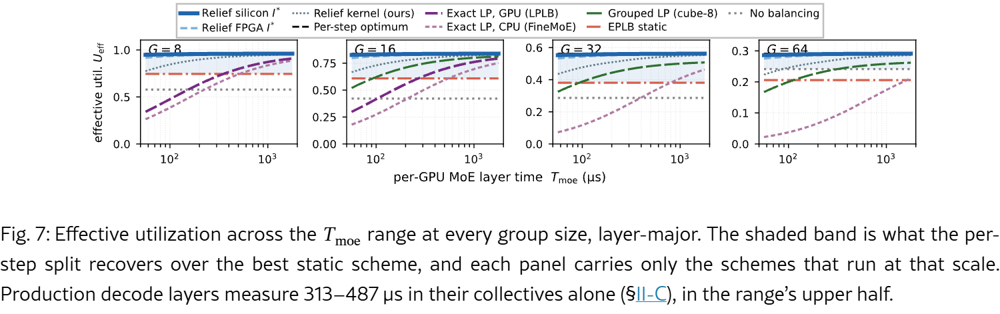

**原论文 Figure 7｜求解成本决定动态调度是否划算。** 横轴表示原始 MoE 层耗时，纵轴是考虑求解时间后的有效利用率，不同子图对应不同 EP 规模。当层本身很短时，精确 LP 即使获得更均衡的结果，也可能因为求解过慢而输给静态方案；Relief 的轻量求解在这些区域更有优势。专用芯片评估中，相对静态放置最多恢复 **37.3 个百分点**的有效利用率；该数值不是 GPU 端到端吞吐增幅。

**（2）并行规模增大后，精确 LP 的开销成为额外瓶颈。**

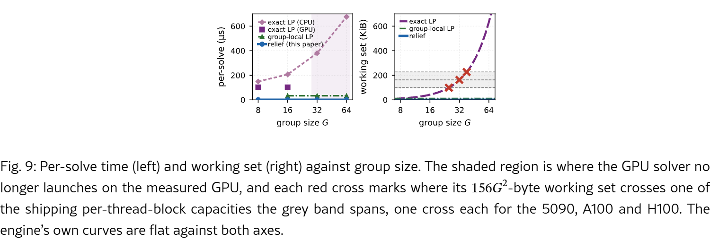

**原论文 Figure 9｜Relief 与 LP 的可扩展性对比。** 左图比较求解时间，右图比较求解器工作内存。精确 LP 的工作内存随 Rank 数平方增长，超过 GPU 共享内存容量后不能直接启动；Relief 的固定功能实现随 EP 规模增加，求解时间变化较小。

| 指标 | 论文报告 |
|---|---|
| GPU 精确 LP | 约 100 μs 量级；大 EP 下受共享内存限制 |
| Relief CUDA 求解器 | 代表性结果约 13–26 μs |
| Relief 专用芯片，固定 12 轮 | EP8/64 约 0.75/0.79 μs（硬件实现评估） |
| 空间利用率 | 128 专家模型的 192 个层/规模组合中，190 个优于其他可部署方法 |

**结论。** Relief 证明了快而近似的求解器可以比慢而精确的求解器更有用。但在两个 EP64 实验层上，默认放置反而更好：再好的 Token 分配也无法完全补救不合适的专家布局。这进一步说明 Placement 和 Dispatch 是两个不同的优化问题。

### 2.6 现有局限与值得进一步研究的问题

**适用边界/研究判断**：Relief 的低成本来自简洁的 Token 负载代理和固定副本关系。对于冷专家，把 Token 平分到两个副本可能引入额外权重装载；对于不同 GEMM 形状，Token 数相等也未必耗时相等。这正是与 TEMPO 产生的研究张力。

**潜在创新**：保留 Relief 的低开销边松弛，但让每条边只选择有利于真实 Critical Path 的动作，例如 `不动 / 搬半差 / 搬至 GEMM Tile 边界`。是否有效必须对比 Relief、TEMPO、LPLB 和在线 Oracle，并把 Planner 时间算进 TPOT。

---

## 3. MegaFlux：既然 Token 不够平衡，能不能直接把专家搬过去？

**论文**：[Skew-Resilient MoE Megakernels via Pipelined Expert Replication](https://arxiv.org/abs/2610.00671) · [PDF](https://arxiv.org/pdf/2610.00671)  
**作者**：Jianzhu Yao、Siva Kumar Sastry Hari、Vignesh Balaji、Sana Damani、Insu Jang、Pramod Viswanath、Christos Kozyrakis。  
**机构**：Princeton University × NVIDIA。**开源状况**：未核实独立完整实现；可参考 [TensorRT-LLM](https://github.com/NVIDIA/TensorRT-LLM) 的公开 MoE 基础实现。

### 3.1 研究背景与问题定义：已有专家副本无法消除热点怎么办？

TEMPO 和 Relief 可以把 Token 重新分给**已有副本**，但如果热点专家只在一块 GPU 上，就没有更多分配自由度。另一种方法是临时复制这个专家的权重，在空闲 GPU 上增加一个副本。

新的问题也随之产生：**复制权重需要显存、互联带宽和同步时间**。如果必须等待整个专家权重复制完成才能开始 GEMM，负载分配虽然更平衡，端到端反而可能更慢。

**MegaFlux 要解决的问题**是：如何把临时专家复制本身纳入 MoE 的实际执行流水线，使复制能够被计算隐藏？

### 3.2 核心算法：输入、输出与基本机制

**一句话：MegaFlux 允许本轮把热点专家权重复制到其他 GPU，然后通过持久化 Megakernel 边搬权重边算，让复制尽量不增加总延迟。**

它与 TEMPO/Relief 的最大不同是：**前两者假设已有副本放置不变；MegaFlux 允许新建物理专家副本。** 这改变了优化的可行域。

### 3.3 核心 Insight：为什么旧方法在这里失效

一个专家 FFN 可以粗略表示为：

$$
Z = X W_1,\qquad H = \sigma(Z),\qquad Y = H W_2.
$$

执行第一段 FC1 只需要 `X` 和 `W1`；第二段 FC2 才需要 `W2`。

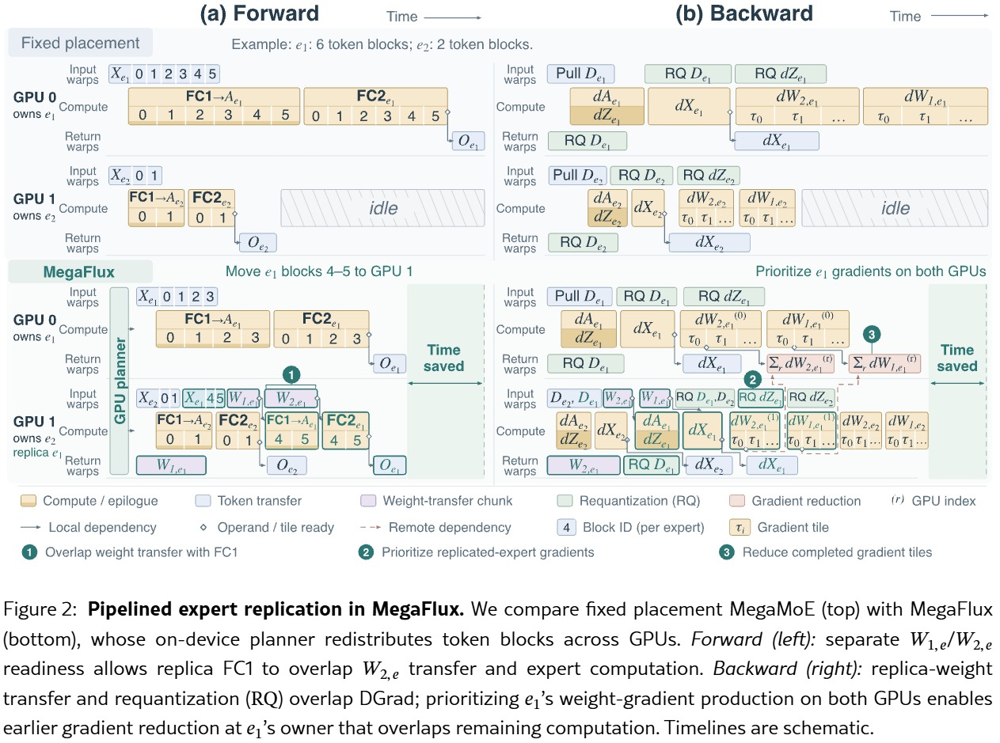

**图 5｜专家权重的复制可以和专家计算同时进行。** 左侧比较固定放置与 MegaFlux：固定放置的热点 GPU 很忙、另一块 GPU 空闲；MegaFlux 把部分 Token 和专家权重搬到空闲 GPU，并让先到达的权重立即参与计算。右侧说明训练时梯度归并也能与其他计算重叠。

常规动态复制很容易写成：

```text
Copy W1 + W2 → Barrier → FC1 → FC2
```

MegaFlux 将它转为：

```text
Copy W1 ──→ FC1 ──────→ FC2
          Copy W2 ────→ ↑
```

**核心不只是异步 memcpy**，而是调整 Kernel 中的 Producer/Consumer 依赖，使传输和计算有真实可重叠的窗口。

### 3.4 算法如何对应问题：逐步解决什么

1. **分块**：将属于每个专家的 Token 切成大小可控的 Tile，以减少随意拆分导致的 Padding。
2. **在线规划**：根据当前每个专家的 Token Tile 数以及可用副本预算，决定哪些专家要复制、哪些 GPU 执行其 Token。
3. **内存预算**：每卡只能拥有有限新增副本，限制额外权重带来的 HBM 占用。
4. **Persistent Kernel**：设备端执行器管理 Token Tile、权重到达和 FC1/FC2 Readiness，而不是为每一步单独引入 CPU/GPU 往返调度。
5. **训练扩展**：如果 Backward 在多张卡上生成梯度，还必须把梯度归并到正确 Owner；该部分是论文额外贡献，不能误认为它一定提升 Serving。

```python
# 仅用于解释机制，不是作者源码
plan = choose_replica_and_token_tile_plan(router_counts, gpu_budget)
for expert_tile in persistent_executor(plan):
    await_ready(expert_tile.inputs, expert_tile.W1)
    run_fc1(expert_tile)           # W2 仍可继续传输
    await_ready(expert_tile.W2)
    run_fc2(expert_tile)
    return_weighted_output(expert_tile)
```

### 3.5 实验结果：负载均衡与权重传输流水线分别带来多少收益？

**实验设置。** 8×B200（单个 NVLink 域，EP8），64/128/256 个专家，Top-8，25% 额外专家副本容量；每个 Rank 输入 1K–64K Token。前向采用 MXFP4 权重、MXFP8 激活。微基准保留真实 Trace 的路由负载分布，同时使用合成权重与激活，以便控制变量。主要基线是同一个 MegaMoE Megakernel 的固定专家放置版本。

**（1）动态复制的收益有多大，取决于路由有多偏斜。**

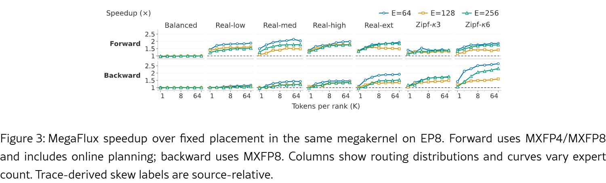

**原论文 Figure 3｜动态复制相对固定放置的性能。** 不同曲线对应专家数，子图对应不同路由分布。路由越不均匀、计算量越足以摊薄复制成本，通常收益越明显。在每个方向的 147 组配置中，前向和反向的几何平均加速比分别为 **1.45×、1.28×**，最高分别达 2.14×、2.64×；对于均匀路由，基本没有加速。

**（2）同样的复制方案，为什么流水线执行更快？**

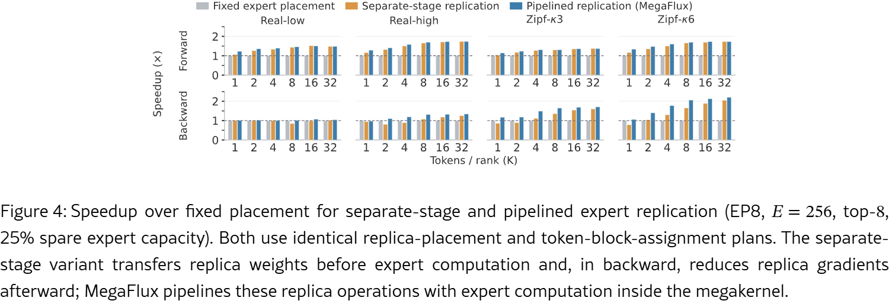

**原论文 Figure 4｜拆分动态复制与流水线的贡献。** 两种复制方案使用相同的专家放置和 Token 分配计划，区别仅在于是否把复制操作与计算一起执行。这组消融说明提升既来自减少热点 GPU 的计算，也来自隐藏复制时间。相比独立执行复制，流水线进一步降低前向延迟最多 13.2%、反向最多 26.7%。作者估计前向隐藏了 56–76% 的权重传输成本。

**（3）真实推理系统是否也有效？**

论文将 MegaFlux 集成到 vLLM，在 8×B200 上用 DeepSeek-V4-Pro 对 160 条 LongBench-Pro Prompt 进行 Prefill 测试。原论文 Table 1 的中位数加速比如下：

| Batch Size | 每 GPU 16K Prefill Chunk | 每 GPU 32K Prefill Chunk |
|---:|---:|---:|
| 8 | 1.128× | 1.133× |
| 16 | 1.227× | 1.238× |
| 32 | 1.165× | 1.260× |

**结论。** MegaFlux 不只是用复制解决负载不均衡，还证明了复制带来的额外通信可以部分隐藏在 Megakernel 内。Prefill 的系统级收益为 **1.13–1.26×**；由于小 Batch 下规划和复制的固定成本占比更高，不能直接推出 Decode 也能获得相同收益。

### 3.6 现有局限与值得进一步研究的问题

**作者说明**：负载已经平衡时，复制往往不值得；某些小 Backward 负载会退化；跨 NVLink Domain 的复制仍需要新的设计；动态启停机制值得继续探索。

**我的判断**：MegaFlux 的成功依赖权重传输可以被 FC1/FC2 或其他计算隐藏。对小 Batch Decode、慢速 RDMA、权重极大或已经饱和的 GPU，复制可能变成显著成本。

**潜在创新**：建立能够判断 `保持现有副本 / 只调整 Token Split / 临时新建副本` 何者值得的成本模型。但不能只把传输字节数除以带宽，必须考虑**实际可以被隐藏的传输时间**。这一方向实现门槛高于固定 Placement 下的 Token 分配。

---

## 4. OverlapAdvisor：通信和计算怎么重叠，没有万能答案

**论文**：[Modeling and Adapting Computation–Communication Overlap for Distributed MoE Serving](https://arxiv.org/abs/2611.11857) · [PDF](https://arxiv.org/pdf/2611.11857)  
**作者**：Chutong Ding、Kaixuan Zhang、Luping Wang、Shiyou Qian、Jian Cao 等。**机构**：Shanghai Jiao Tong University × Alibaba Group。  
**代码**：论文报告在 SGLang / vLLM 进行验证；未核实完整独立公开仓库。

### 4.1 研究背景与问题定义：通信重叠为什么没有万能方案？

在分布式 MoE 中，Token Dispatch、Expert GEMM、Combine 构成相互依赖的工作链。不同推理框架提供不同的融合、分块和计算通信重叠方案，但**没有一种固定策略能同时适合所有 Token Shape、模型、并行度与互联设备**。

**OverlapAdvisor 研究的问题**是：部署系统时如何以较低成本预测各个执行方案的真实延迟，进而选出合适的通信计算重叠策略？它的主要决定发生在启动/配置阶段，不等于在每个 Decode Step 动态切换。

### 4.2 核心算法：输入、输出与基本机制

**一句话：OverlapAdvisor 不强迫所有机器使用同一种 MoE Kernel，而是先预测不同计算通信重叠方式在当前部署配置下谁最快，然后在启动时选择。**

注意它主要优化的是 **Backend/Overlap Strategy Selection**，不是逻辑 Router，也不是像 Relief 那样每步重新分 Token。

### 4.3 核心 Insight：为什么旧方法在这里失效

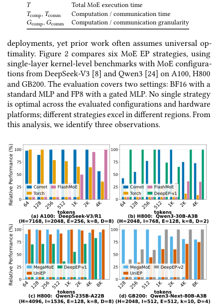

**图 6｜没有一种通信—计算重叠策略在所有情况下都最快。** 四个子图对应不同 GPU、模型及精度配置；横轴是处理的 Token 数，纵轴为相对最佳策略的性能（最佳为 100%）。不同颜色分别代表不同执行方案，最佳方案会随硬件和负载变化。

考虑通信需要 80 μs、计算需要 100 μs：

```text
完全串行：80 + 100 = 180 μs
理想完全重叠：max(80, 100) = 100 μs
真实执行：往往介于二者之间（还可能存在额外的资源争用）
```

为什么不能直接认为 100 μs 就是正确结果？因为 Token Tile 必须到达后才能计算；Combine 又要等待 Expert 输出；通信 Warps、GEMM 和缓存访问可能互相争抢资源。不同的 Chunk Size 与执行后端还会改变这些依赖。

### 4.4 算法如何对应问题：逐步解决什么

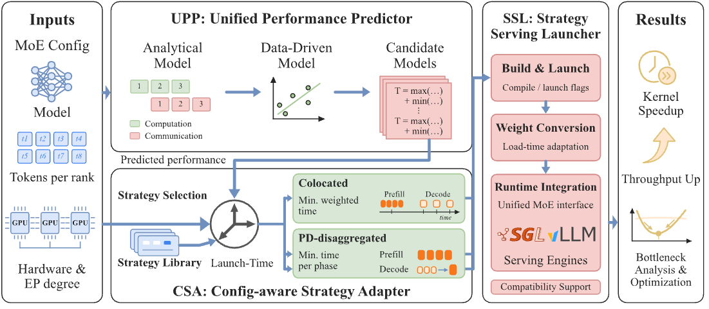

**图 7｜OverlapAdvisor 的完整决策流程。** 左侧输入模型、Token 数、GPU 与 EP 配置；中间先估算候选方案的通信和计算耗时，再挑选适合当前配置的执行策略；右侧将该策略交给 SGLang/vLLM 启动运行，并分析最终吞吐和延迟。

**UPP（Unified Performance Predictor）**：建立分阶段性能模型，估计 Dispatch+Compute、Compute+Combine 等关键路径，结合少量真实测量校准有效带宽、GEMM 效率和同步开销。

**CSA（Configuration-aware Strategy Adapter）**：根据模型、EP Degree、硬件、Prefill/Decode 比例等信息评估候选策略，选择预计耗时最小者。

**SSL（Strategy Serving Launcher）**：将被选策略接入具体 Serving Engine 的启动、权重布局和 Kernel 执行路径。

```python
# 教学伪代码：主要为 Launch-time 选择
for backend in available_moe_backends:
    predicted[backend] = estimate_latency(backend, model_shape, topology, workload)
start_serving_engine(backend=min(predicted, key=predicted.get))
```

**一个重要事实**：论文的核心策略选择发生在**启动/配置阶段**，不能把它理解为“每个 Decode Step 都动态选择后端”。

### 4.5 实验结果：选择最合适的执行策略能带来多大收益？

**实验设置。** 覆盖 A100、H20、H800、GB200 四种 GPU 平台，103 种真实模型配置（MoE Shape），Token 数 32–16K。Kernel 层比较 Comet、FlashMoE、Torch、DeepEP、MegaMoE、UniEP 等可运行的固定方案；系统层在 SGLang 和 vLLM 中比较 MegaMoE、UniEP、DeepEP，覆盖 Prefill/Decode 混合部署及 PD 分离。

**（1）Kernel 性能：相对各平台最强的固定后端仍有收益。**

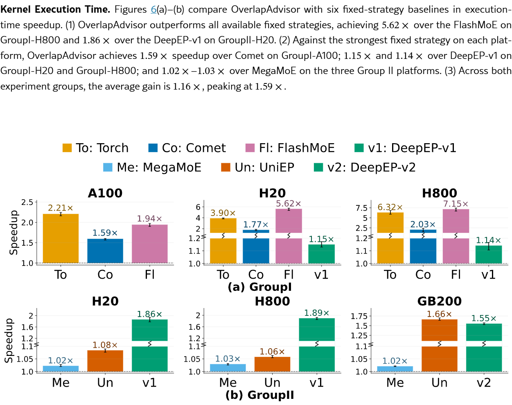

**原论文 Figure 6｜自动选择策略与固定方案的对比。** 不同柱子表示不同基线。如果选择始终固定的后端，它可能在部分模型形状上明显落后；OverlapAdvisor 根据当前部署配置挑选执行策略。相对各平台最强固定策略的平均加速为 1.16×，最高平台平均加速为 1.59×。但在 FP8、MegaMoE 已经表现很好的配置组中，平均收益只有约 2–3%。

| 平台与配置组 | 最强固定基线 | Kernel 加速 |
|---|---|---:|
| A100，BF16 | Comet | 1.59× |
| H20，BF16 | DeepEP-v1 | 1.15× |
| H800，BF16 | DeepEP-v1 | 1.14× |
| FP8 三个平台 | MegaMoE | 1.02–1.03× |

**（2）端到端系统：策略选择收益依赖系统本来使用的后端。**

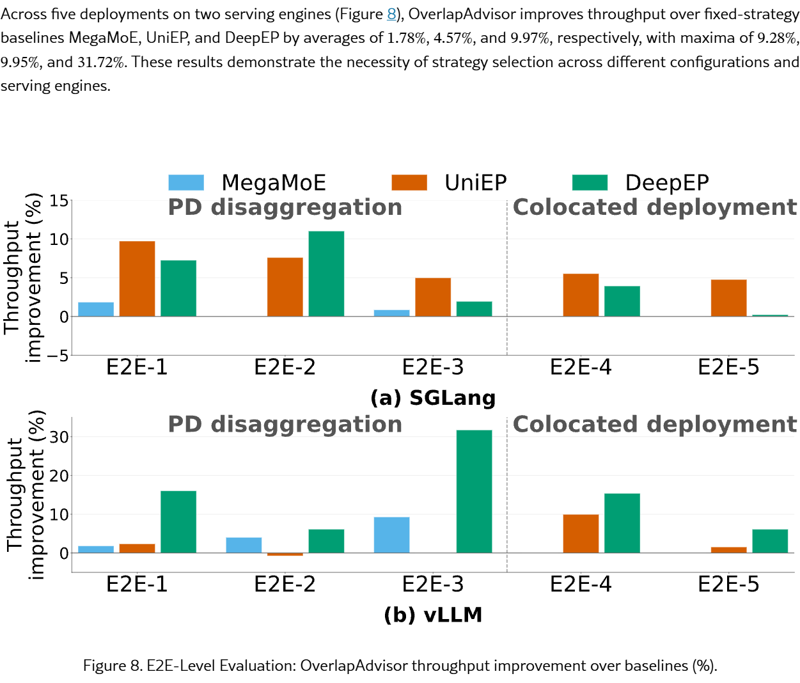

**原论文 Figure 8｜五种部署配置中的服务吞吐变化。** 图中区分引擎、模型及部署方式，比对相同部署下固定后端与自动选择的吞吐量。相比本来已经很高效的 MegaMoE，平均增益有限；如果初始部署使用了不合适的 DeepEP 或 UniEP 策略，重新选择的价值更明显。

| 固定系统基线 | 平均吞吐提升 | 最大吞吐提升 |
|---|---:|---:|
| MegaMoE | 1.78% | 9.28% |
| UniEP | 4.57% | 9.95% |
| DeepEP | 9.97% | 31.72% |

性能预测模型的 MAPE 为 3.3–15.9%，启动时选择策略约需 6 μs；服务过程中不需要反复预测和调度。

**结论。** OverlapAdvisor 证明了通信计算重叠需要针对具体模型和硬件选择，而不是使用固定的最优后端。它尤其擅长规避选错策略的性能损失，而非让所有成熟后端都提高 30%。该方法主要解决启动时的静态选择，尚未直接说明运行时频繁变化的 Batch 应如何处理。

### 4.6 现有局限与值得进一步研究的问题

**作者讨论的延伸**：多节点、细粒度 SM/Warp 资源争用、模型跨平台迁移与复杂执行路径的拟合仍值得加强。

**我的判断**：模型和部署配置不变，不代表实时负载不变。连续批处理中的 Batch/Router Skew/Prefill–Decode 比例可以变化。但动态切换后端又要付出 CUDA Graph、权重排布、Workspace 或重新编译等成本。

**潜在创新**：研究“什么时候值得从稳定的 Launch-time Backend 切换到在线策略”。需要把收益、切换代价与波动稳定性同时建模，和固定策略、Oracle、简单阈值策略比较。

---

## 5. 四篇论文合在一起，我们真正学到了什么？

| 对比维度 | TEMPO | Relief | MegaFlux | OverlapAdvisor |
|---|---|---|---|---|
| 先解决的难点 | **优化目标不准确** | **求解器太慢** | **现有副本不够、权重搬运昂贵** | **不同执行后端没有通用最优者** |
| 核心技术 | 非线性 GPU Cost Model + 启发式 | 整数成对松弛 + Edge Coloring | 动态复制 + Megakernel Pipeline | 分阶段预测 + 策略选择 |
| 能否创建新的专家副本 | 否 | 否 | **是** | 通常否 |
| 决策时间尺度 | 后台异步更新 | **逐 Decode Step** | 当前 Kernel 执行阶段 | **启动阶段** |
| 最重要局限 | 负载信息可能过时 | Token 均衡未必等于真实耗时均衡 | 复制是否划算取决于可隐藏通信 | 不直接处理实时变化与切换代价 |
| 最值得学习的思想 | 真实 Makespan 优先于 Token 数 | 决策成本是算法成本的一部分 | 用细粒度依赖隐藏复制传输 | 策略选择本身需要成本模型 |

### 5.1 推荐优先研究的问题：真正 Cost-aware 的逐步 Dispatch

**研究问题**：可否在每个 Decode Step 中，以 Relief 级别的低开销，利用 TEMPO 级别的真实代价信号分配 Token，同时给出何时关闭调度的判断？

**为什么可能有价值**：Relief 为快放弃了复杂目标，TEMPO 为准确选择后台异步规划；二者存在明确的 Accuracy–Latency Trade-off。

**但这还不是论文贡献。** 必须在真实 GPU 上先证明一个“Relief Token 数更均匀，但耗时反而增加”的可复现实例，并证明现有 TEMPO 异步版本因为 Staleness 或规划粒度没有解决该反例。

候选最低成本算法：

```text
对于一条有两个专家副本的 GPU 边：
  候选 A：保持分配
  候选 B：转移当前负载差的一半
  候选 C：移动至 GEMM Tile Boundary
  对候选预测 (GEMM + 额外同步 + 通信关键路径)
  仅当节省超过规划和模型误差门槛时转移
```

需要 **LPLB / Relief / TEMPO / Static EPLB / Offline Oracle** 共同对照，所有方法的输出 Token 应完全一致。

### 5.2 第二条研究线：跨时间尺度的 EP Execution Planning

慢时间尺度选择 Replica Placement，较快时间尺度选择 Token Split，更快时间尺度决定 Communication/GEMM 的执行粒度。把它们串起来不是简单拼接，因为**改变专家副本、后端、分块大小，可能同时改变原先的最优解与调度成本**。

适合作为下一阶段，但需要对 TEMPO、MegaFlux、OverlapAdvisor 给出系统性失效反例；否则容易只是已有方法的集成工程。

### 5.3 实验设计与止损标准

| 层次 | 必测指标 | 作用 |
|---|---|---|
| 路由 | 每层专家直方图、Top-K、跨 Step 自相关、偏斜分布 | 判断是否真的存在逐步动态优化机会 |
| 计算 | Activated Expert Count、Grouped GEMM、M-Tile Padding | 复现 TEMPO 的非线性成本 |
| 通信 | Dispatch、Combine、权重搬运、实际 Overlap | 判断何时 Network-bound |
| 调度器 | Planner Latency、Staleness、CUDA Graph 兼容性 | 防止优化成本吃掉收益 |
| 端到端 | Prefill TTFT、Decode TPOT、P95/P99、Tokens/s | 验证优化不是局部幻象 |


