# MoE 推理系统论文精读：TEMPO 与 MegaScale-Infer

## 1. TEMPO：先搞清楚「什么叫负载均衡」

**论文**：[TEMPO: Makespan-Aware Expert-Parallel Load Balancing Across Memory- and Compute-Bound Regimes](https://arxiv.org/abs/2608.13057) · [PDF](https://arxiv.org/pdf/2608.13057)  
**作者**：Jie Li、Chenxin Jia、Jinliang Shen、Cunzhuang Liu 等；Chengru Song 为通讯作者。  
**机构**：KlingAI Research。**代码**：论文提到的 [TEMPO 仓库](https://github.com/jeshxxx/TEMPO)，公开可用性尚未确认。

### 1.1 研究背景与问题定义：均衡 Token 为什么还会拖尾？

传统 EP 的一个简单基线是将同一逻辑专家的 Token 分给不同物理副本，让各 GPU 接收的 Token 总数尽量接近。问题是 Grouped GEMM 的实际耗时不仅取决于 Token 数，还取决于被激活的专家副本数量、读入的专家权重以及 Tile Padding。

**TEMPO 研究的不是如何改变模型 Router，而是：保持 Top-K 专家不变、已有专家副本位置不变，怎样决定每个副本执行多少 Token，才能减少最慢 GPU 的真实执行时间？**

该问题在冷专家与热专家混合的 Decode Batch 中尤其突出：冷专家可能每次都需要支付读权重的固定成本，热专家的 GEMM 才可能随 Token 数显著增长。

### 1.2 核心算法：输入、输出与基本机制

**一句话：TEMPO 不追求每张 GPU 分到同样多的 Token，而是预测每张 GPU 处理这些 Token 需要多长时间，再最小化最慢 GPU 的耗时。**

输入是某层当前各逻辑专家收到的 Token 数 `n[e]` 和已经存在的专家副本位置；输出是每个专家在各合法 GPU 上的 Token Split。

令 `x[e,g]` 表示专家 `e` 在 GPU `g` 上执行的 Token 数：

```text
约束 1：对任意专家 e，sum_g x[e,g] = n[e]
约束 2：只有 GPU g 存在专家 e 的物理副本时，x[e,g] 才能 > 0
目标：minimize max_g PredictedTime(g, x)
```

这和传统 LPLB 主要最小化每卡 Token 数的最大值相比，改变的是**优化目标函数**。

### 1.3 核心 Insight：为什么旧方法在这里失效

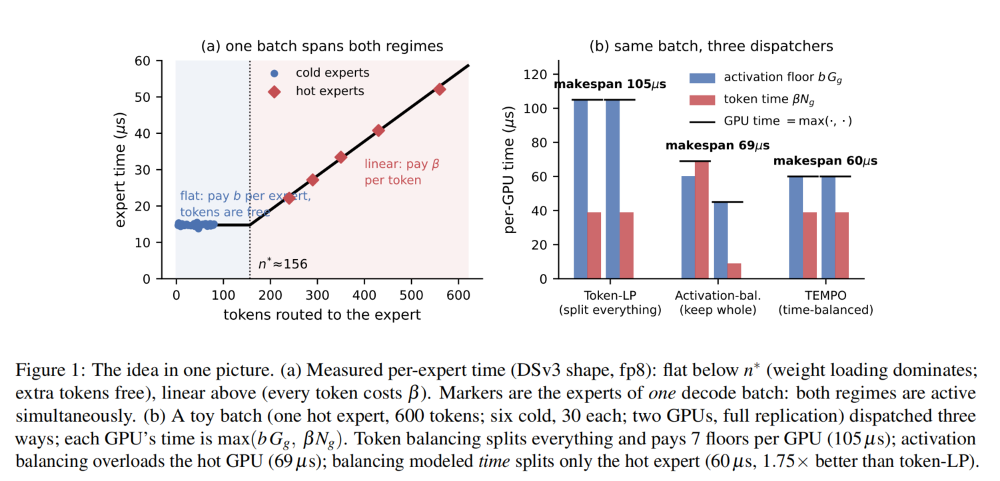

**图 1｜Token 分得一样多，不代表 GPU 用时一样长（TEMPO 原文 Figure 1）** 左图：单个专家的 Token 较少时，执行时间几乎不变；超过约 156 个 Token 后，时间才随计算量明显增长。右图：针对同一批请求，按 Token 数平分的方案反而比 TEMPO 的时间感知分配更慢。

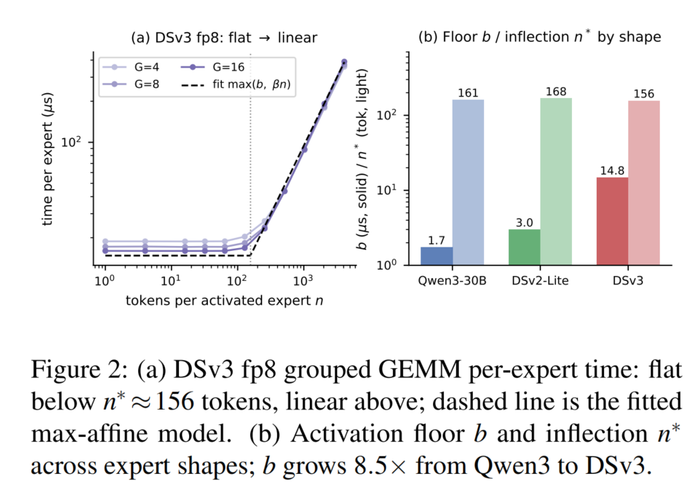

**图 2｜专家计算存在“固定开销区”和“计算增长区”（TEMPO 原文 Figure 2）** 左图：每个专家的执行时间先接近水平线，Token 足够多后才上升。右图：不同模型形状的转折点并不相同，所以调度器需要针对模型和 GPU 测量成本，不能使用一个通用的 Token 阈值。

**为什么？** 每激活一个物理 Expert，就可能要从 HBM 读一次权重。冷专家仅有少量 Token 时，多复制一个执行位置通常意味着多支付一份固定读权重开销；热专家有大量 Token 时，更可能受 GEMM 计算量约束。

TEMPO 把每个 GPU 的估计时间近似写成：

$$
\widehat{T}_g = \max(a+bG_g,\;c+\beta N_g).
$$

- `G_g`：GPU `g` 本步激活的物理专家副本数；
- `N_g`：它需要处理的 Token 总数；
- `a+bG_g`：更多地反映 Weight Streaming / 启动地板；
- `c+βN_g`：更多地反映计算主导的部分。

**直白例子**：一个冷专家只有 10 个 Token，却有 GPU0/GPU1 两份权重。如果全放 GPU0，本次只激活一份；若为了“均匀”平分为 5+5，两个 GPU 都必须读取这个专家的权重。看起来 Token 更平衡，实际执行可能更慢。反之，600 个 Token 的热专家分给两卡，可能显著降低 GEMM 拖尾。

### 1.4 算法如何对应问题：逐步解决什么

TEMPO 的处理分为几个阶段：

1. **离线测量**：在目标硬件、量化、Grouped GEMM Kernel 和 Token Shape 下标定执行时间，拟合上面的混合成本模型以及 Tile Padding 修正。
2. **先整体分配 Expert**：用贪心方案把专家 Token 尽量放到边际成本低的物理副本，避免过早把大量冷专家拆得很碎。
3. **改善冷专家区间**：通过增广链调整专家执行位置，降低不必要的激活副本数。
4. **改善热专家区间**：对瓶颈 GPU 上的热专家做局部搬移或部分 Split，降低最大的预测完成时间。
5. **比较安全候选**：把调度结果同简单 Token LP 等基线按同一预测模型评价，优势不明显时可以保持原方案。

```python
# 教学伪代码，并非 TEMPO 作者源码
cost = calibrate_real_grouped_gemm()
assignment = greedy_whole_expert_placement(expert_counts, replicas)
assignment = reduce_unnecessary_activated_replicas(assignment, cost)
assignment = split_hot_experts_on_bottleneck_gpus(assignment, cost)
publish_assignment_async(assignment)
```

特别注意 **Async**：TEMPO 把部分求解工作放在后台，利用近期负载统计更新 Dispatch Table，执行侧读最新的表。这减少求解器对当前 GPU Critical Path 的影响，但表可能落后于正在发生的路由变化。

### 1.5 实验结果：成本模型在哪些场景真正有用？

**实验设置。** 论文使用两代数据中心 GPU（具体型号匿名），在 EP8 上进行实机微基准和 SGLang 端到端测试，并将成本模型扩展至 EP32–64 的模拟实验。端到端主要比较 Qwen3-235B-A22B-FP8 和 DeepSeek-V3，基线包括静态 EPLB、均匀副本分配和 Token-LP。

**（1）负载不同时，正确的均衡方式也不同。**


**图 3｜不同负载下的性能相图（TEMPO 原文 Figure 6）** 横轴与纵轴分别描述 Batch 大小和专家路由偏斜程度；字母标记当前条件下最好的固定策略，颜色与数字表示 TEMPO 相对该策略的收益。小 Batch 更适合减少被激活的专家副本，大 Batch 更适合分担 Token 计算，混合区间则需要同时考虑二者。作者报告 TEMPO 在模拟网格上与最佳固定策略的差距不超过 1%，部分混合区间收益最高达 15.5%（最大收益包含 EP32–64 的模型外推，并非全规模实机结果）。

**（2）端到端验证：同一算法在不同模型上可以一赢一输。**

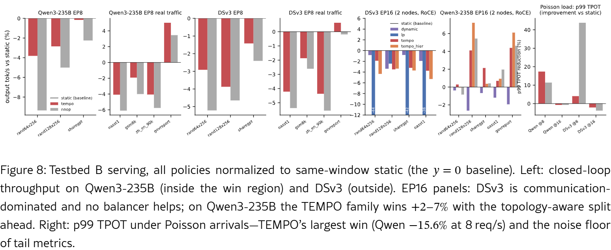

**图 4｜真实服务吞吐与 P99 TPOT（TEMPO 原文 Figure 8）** 图中以同一测量窗口的静态策略为参照，比较多种分配方法。Qwen3-235B 在长文档摘要等负载有收益，而 DeepSeek-V3 在通信占主导的设置下没有收益。

| 场景 | TEMPO 相对静态策略的结果 |
|---|---|
| Qwen3-235B，GovReport | 吞吐中位数提升约 5% |
| Qwen3-235B，Poisson 到达（8 请求/s） | P99 TPOT 从 226 ms 降至 191 ms（−15.6%） |
| Qwen3-235B，双节点 EP16 | 拓扑感知分配在相关负载下提升约 4–7% |
| DeepSeek-V3，通信占主导 | 各负载吞吐下降约 2–3% |

**结论。** TEMPO 最有价值的结果并非最大加速比，而是证明负载均衡存在明确的适用区间。真实耗时模型能够解释不同策略何时有效，也能预测什么时候不该增加调度开销。论文还发现，相对原版 LPLB 的部分大幅收益来自移除逐层通信和调度开销，不能全部归功于成本目标函数。

### 1.6 现有局限与值得进一步研究的问题

**作者说明**：成本模型依赖硬件与 Kernel 标定；仅用 `G` 和 `N` 尚未完整刻画专家 Slot 分布；后端异步更新导致 Routing Table 陈旧；在通信占优的工作负载上未必有收益；多节点更复杂的网络成本仍需建模。

**我的研究判断**：TEMPO 改善了“决策目标”，但没有真正实现**当前 Step、低开销、成本感知**的在线精细分配。

**潜在创新**：设计一种 Staleness-aware Dispatcher：根据专家热点变化速度决定继续用后台表、在本步快速修正，或者直接回退到简单规则。需要比较“预测准确率”之外的真实 TPOT / Planner Overhead / P99。


---

## 2. MegaScale-Infer：为什么 Attention 与 FFN 必须放在同一组 GPU 上？

**论文**：[MegaScale-Infer: Efficient Mixture-of-Experts Model Serving with Disaggregated Expert Parallelism](https://doi.org/10.1145/3718958.3750506) · [SIGCOMM 2025 正式版 PDF](https://chaojin0310.github.io/files/papers/SIGCOMM25-MegaScale-Infer.pdf)  
**作者**：Ruidong Zhu、Ziheng Jiang、Chao Jin（共同一作）、Peng Wu、Cesar A. Stuardo 等。  
**机构**：北京大学计算机学院、字节跳动。**代码**：未确认原系统完整公开实现；可参考 [SGLang AF 分离讨论](https://github.com/sgl-project/sglang/issues/9401)。

### 2.1 研究背景与问题定义：为什么 MoE 的稀疏计算没有等比例降低推理成本？

MoE 的优势是每个 Token 只激活少数专家。然而，从模型层面减少 FLOPs，并不意味着 GPU 的执行时间会按相同比例降低。

在 Decode 阶段，Attention 需要读取各个请求独有的 KV Cache。上下文越长，并发请求越多，显存容量与访存带宽的压力就越大；FFN 则可以让不同 Token 共享同一份专家权重，但只有同一个专家收到足够多的 Token，才能摊薄读取权重的成本。

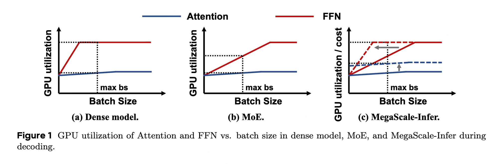

**图 5｜Dense、MoE 与分离式 MoE 的 GPU 利用率（MegaScale-Infer 原文 Figure 1）** 左图中 Dense FFN 随 Batch 增长能够较快达到计算饱和；中图中 MoE 的 Token 被分散到不同专家，达到 Batch 上限时 FFN 仍可能没有充分利用 GPU；右图说明拆分资源后，可以扩大专家的有效 Batch，或为不同模块选择性价比更高的硬件。该图解释设计动机，并非具体模型的实测曲线。

关键矛盾是：**Attention 限制整个系统能够容纳的 Batch，而 FFN 恰恰需要更大的 Batch 才能高效执行。** 单纯增加传统完整模型副本，往往同时增加 Attention 与 Expert 权重副本，无法独立控制二者的比例。

MegaScale-Infer 的研究问题是：在不改变模型 Router、不减少专家计算的前提下，能否释放 Attention 对 Expert Batch 的限制，同时控制新增通信和单 Token 延迟？

### 2.2 核心算法：把模型层拆成两个独立资源池

MegaScale-Infer 提出 Disaggregated Expert Parallelism，即在每个 Transformer Layer 内分离 Attention 和 Expert FFN：

- Attention Pool：多个 Attention Replica 保存各自请求的 KV Cache；副本之间进行 DP，副本内部可使用 TP。
- Expert Pool：各 Expert Node 保存专家权重，组成 EP Group；单个专家节点也可以使用 TP。
- 每个 Attention Replica 完成 Attention 与路由后，把中间激活发送到对应 Expert Node；专家计算完成后将结果送回 Attention 侧聚合，进入下一层。

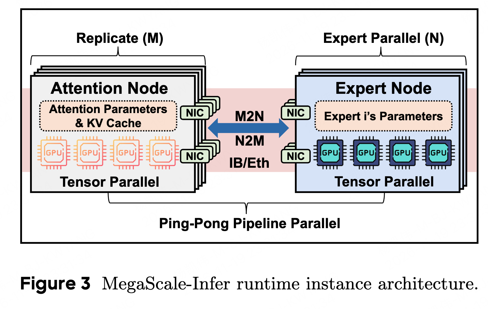

**图 6｜MegaScale-Infer 的运行时架构（MegaScale-Infer 原文 Figure 3）** 左边是一组 Attention 副本，各自保存 Attention 权重和 KV Cache；右边是按专家划分的 Expert 节点。中间双向箭头表示两组 GPU 之间的激活值和输出交换。Attention 副本数与 Expert 并行规模不必相等。

这种设计类似 PD 分离，但切分对象不同：

| | PD 分离 | AF 分离（MegaScale-Infer） |
|---|---|---|
| 切分维度 | Prefill / Decode 两个阶段 | 每一层的 Attention / FFN |
| 主要传输 | 阶段交接时的 KV Cache | 每一层的中间激活与专家输出 |
| 优化目的 | 减少长 Prefill 对 Decode 的干扰 | 增大专家有效 Batch，独立配置资源 |
| 新增开销 | 状态迁移与调度 | 高频通信及流水线等待 |

MegaScale-Infer 本身也将 Prefill 与 Decode 分在不同集群，主要研究 Decode 集群内部的 AF 分离。因此两种方法可以同时使用。

### 2.3 核心 Insight：让同一份专家权重服务更多 Token

假设一个模型有 $E$ 个专家，每个 Token 选择 $K$ 个专家，每个 Attention 副本在一个 Microbatch 中处理 $b_a$ 个 Token，总共有 $n_a$ 个 Attention 副本。若专家负载均匀，则：

$$
\overline{b_e}=\frac{n_a b_a K}{E}.
$$

$\overline{b_e}$ 为单个专家平均处理的 Token 数。这个公式是平均量，不保证每个专家的实际负载一致。

举例：$E=8$，$K=2$，单个 Attention 副本一次只处理 128 个 Token。

| Attention 副本数 | 专家池总请求 Token 数 | 每个专家平均 Token 数 |
|---:|---:|---:|
| 1 | 128 | 32 |
| 2 | 256 | 64 |
| 4 | 512 | 128 |
| 8 | 1024 | 256 |

多个 Attention 副本共享 Expert Pool，就能提高 Expert GEMM 的 M 维度，而不需要每个 Attention 副本单独保存所有专家权重。

从 Roofline 的角度理解，若一次 BF16 GEMM 的输入为 $b\times h$、权重为 $h\times d$，暂时只考虑权重读取，则算术强度近似为：

$$
I\approx\frac{2bhd}{2hd}=b\quad\mathrm{FLOP/byte}.
$$

当 $b$ 很小时，GEMM 即使 FLOPs 很少，也可能主要在等待权重读取；增大 $b$ 能让同一份权重参与更多计算，提高计算单元利用率。真实 GEMM 还受到激活、中间结果、量化、Tile Padding 等影响，因此不能把上式当作准确的执行时间模型。

这就是为什么 AF 分离不是简单地把算子放到另一张 GPU：**它改变了专家接收 Token 的规模，使原来受访存限制的计算有机会转向更高的计算利用率。**

### 2.4 算法如何对应问题：Ping-Pong 流水线、部署搜索与 M2N 通信

**（1）Ping-Pong Pipeline：解决两类 GPU 轮流空闲的问题。**

如果只有一个 Batch，Attention 执行时 Expert Pool 空闲，Expert 执行时 Attention Pool 又空闲。直接拆分会让利用率进一步下降。

作者将请求切分成多个 Microbatch，让不同 Microbatch 分别占用 Attention、A2E 通信、Expert 和 E2A 通信阶段。

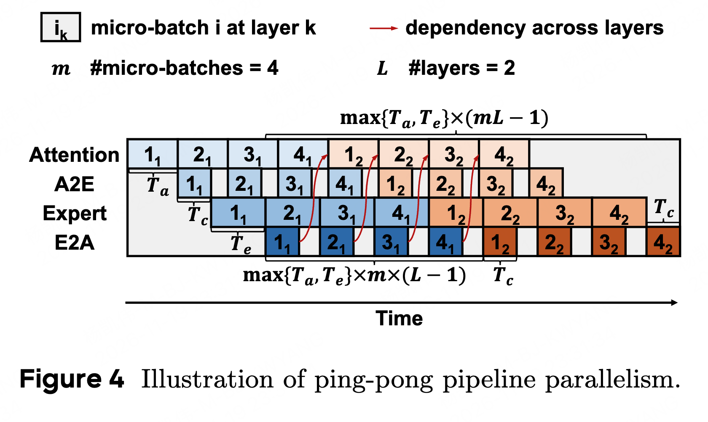

**图 7｜四个 Microbatch 在两个模型层之间的乒乓执行（MegaScale-Infer 原文 Figure 4）** 四行分别表示 Attention、发往 Expert 的通信、Expert 计算和返回 Attention 的通信。横轴是时间。同一个 Microbatch 必须等上一层 Expert 结果返回才能进入下一层，但另一组请求可以利用这段时间执行 Attention。这将原本的等待时间转变为其他请求的计算时间。

论文用 $T_a$、$T_e$、$T_c$ 分别表示单个 Microbatch 的 Attention、Expert 和单向通信时间，令：

$$
T_f=\max(T_a,T_e).
$$

在论文的简化流水线模型中，充分利用流水线需要满足：

$$
T_a\approx T_e,\qquad T_c<T_f,\qquad mT_f\geq 2(T_f+T_c).
$$

其中 $m$ 是 Microbatch 数量。前两条分别约束计算阶段平衡、通信能够被计算覆盖；第三条要求有足够多的独立工作填满管线。

例如，两侧计算各需要 100 μs，单向通信 30 μs，按上述条件至少需要 3 个 Microbatch。如果通信变成 80 μs，则至少需要 4 个。这个计算只解释理想流水线的设计门槛，不意味着真实系统必然达到完全重叠。

**（2）部署配置搜索：解决 Attention 和 Expert 速度不匹配的问题。**

即使 Microbatch 数量足够，如果 Attention 比 Expert 快很多，Expert Pool 仍会成为瓶颈；反之，Expert Pool 将长期等待输入。因此作者将资源配置也纳入优化。

搜索变量包括 Attention 与 Expert 的 TP、Attention 副本数、Microbatch 数及全局 Batch。论文基于算子 profiling、通信带宽和 KV Cache 容量建立预测模型，在时延 SLO 下搜索可容纳的 Batch，并选择单位硬件成本吞吐最高的方案。

用简化的形式表达其目标：

$$
\max\frac{B/T_{\mathrm{total}}}{C_{\mathrm{attention}}+C_{\mathrm{expert}}}
\quad\text{s.t.}\quad
T_{\mathrm{iter}}\leq \mathrm{SLO},\quad
M_{\mathrm{used}}\leq M_{\mathrm{available}}.
$$

这里的 $B$ 表示全局 Batch，$C$ 表示相应资源成本。关键在于同时选择资源比例和工作量，而非先固定机器数量、再独立调节 Batch。

**（3）M2N 通信：解决每层跨节点交换的固定开销。**

AF 分离把传统 EP 的同组 All-to-All 转化为两组设备之间的多对多交换。Attention 路由之后，Token 需要发给动态选中的专家；下一次跨层执行又需要取回结果。

作者采用预注册 GPU Buffer、RDMA Write with Immediate、完成队列轮询及 CUDA Stream 控制，减少中间数据拷贝、通用通信组建立和同步开销。其目标是在每次消息不大的情况下缩短通信延迟，使 Ping-Pong Pipeline 有机会满足 $T_c<T_f$。

三项设计的对应关系如下：

| 原有问题 | 对应方法 | 解决机制 |
|---|---|---|
| 专家 Batch 小、权重复用不足 | AF 分离 | 汇集多个 Attention 副本的 Token |
| 两侧计算互相等待 | Ping-Pong Pipeline | 用其他 Microbatch 填充等待时间 |
| 两侧速度与资源价格不匹配 | 部署搜索与异构 GPU | 根据时延约束调整资源比例 |
| 每层跨节点传输过重 | M2N 通信库 | 降低小消息固定开销与尾延迟 |

### 2.5 实验结果：拆分架构到底增加了吞吐，还是只是增加通信？

**实验设置。** 论文使用 Mixtral 8×22B（141B 参数）、DBRX（132B）与 Scaled-MoE（317B），比较 vLLM 和 TensorRT-LLM。在 8 台各含 8 张 80GB Ampere GPU 的同构集群及 H20/L40S 异构集群上评估；采用 BF16，生产负载的输入、输出长度中位数分别为 571、159 Token。Decode 的 TBT 目标为 150 ms。以下数据均来自正式版第 7 节。

**（1）同构部署：Decode 吞吐明显增长，单 Token 延迟没有同步下降。**

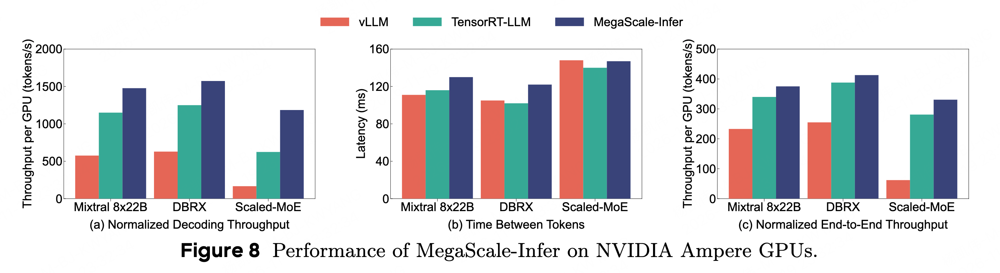

**图 8｜同构 GPU 下的 Decode 吞吐、TBT 与端到端吞吐（MegaScale-Infer 原文 Figure 8）** 左图比较单卡 Decode 吞吐，中图比较生成两个 Token 之间的平均时间，右图把 Prefill 也计入整体吞吐。拆分显著提高 Decode 阶段的吞吐，但中图并没有出现同样幅度的延迟下降，右图的整体收益也更小。

以 Scaled-MoE 为例，相对当时的 TensorRT-LLM 单卡 Decode 吞吐最高为 1.90×；相对该论文的 vLLM 基线为 7.11×（受到当时多节点基线实现限制）。把 Prefill 一并计入后，相对较强基线最高为 1.18×。因此不能将 Decode 的最高收益理解为整个请求加速 1.90×。

**（2）异构部署：根据模块需求选择 GPU，比一味增加高端 GPU 更划算。**

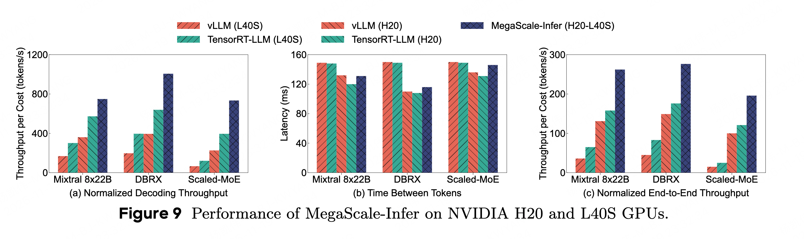

**图 9｜H20 与 L40S 异构部署的单位成本吞吐（MegaScale-Infer 原文 Figure 9）** Attention 采用显存与带宽性价比较高的 H20，Expert 采用计算性价比较高的 L40S。左图显示 Decode 的单位硬件成本吞吐提高，中图显示延迟仍处于相近范围，右图显示端到端成本效率的改善。

| 异构实验指标 | 相对 H20 上 TensorRT-LLM 等基线的论文结果 |
|---|---:|
| Decode 单位硬件成本吞吐 | 最高 1.86×（TensorRT-LLM） |
| 包含 Prefill 的单位成本吞吐 | 最高 1.66× |
| Decode 单位功耗吞吐 | 最高 1.80× |
| 端到端单位功耗吞吐 | 最高 1.72× |

成本结果依赖论文采用的 GPU 价格与网络配置，不能直接套用其他采购价格或云服务价格。

**（3）通信库是否足够快：小消息和尾延迟是 AF 分离能否成立的前提。**

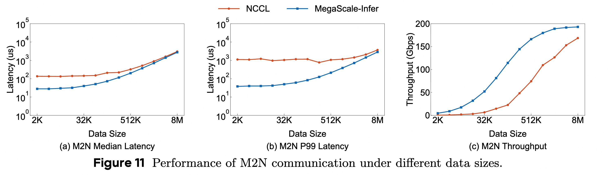

**图 10｜M2N 在不同消息大小下的性能（MegaScale-Infer 原文 Figure 11）** 从左到右分别是中位延迟、P99 延迟和吞吐，蓝线表示定制 M2N，橙线表示 NCCL。在消息较小时，降低固定开销的效果最明显；随消息变大，双方吞吐逐渐逼近带宽上限。在 256 KB 的典型消息下，作者报告中位延迟降低 68.2%、P99 降低 92.9%、吞吐提高 4.2×。这些是通信微基准结果，不是整个模型的加速比。

**（4）流水线是不是切得越细越好？**

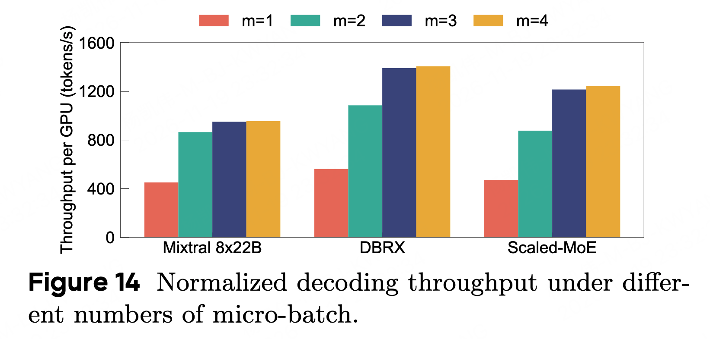

**图 11｜不同 Microbatch 数量下的 Decode 吞吐（MegaScale-Infer 原文 Figure 14）** 从 1 个 Microbatch 增加至 2 个后，两类计算池可以同时处理不同请求；增加到 3 个时，又能覆盖更多通信时间。继续增加到 4 个的收益已经较小。该消融固定每个 Microbatch 的大小，并非固定总 Batch。

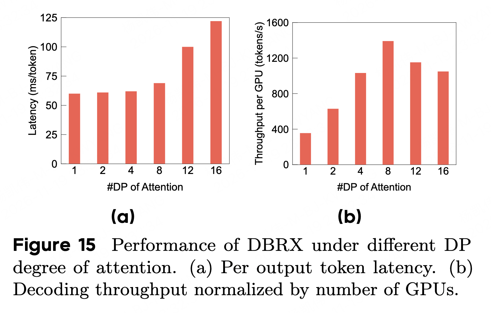

**图 12｜Attention DP 数量对 DBRX 推理性能的影响（MegaScale-Infer 原文 Figure 15）** 左图为单 Token 延迟，右图为单卡吞吐。当 Attention 副本较少时，Expert Pool 等待 Attention 输出；DP 增至 8 时吞吐达到峰值；继续增至 12 或 16，Expert 侧成为瓶颈，延迟上升、单卡吞吐反而下降。

**实验结论。** 该工作最重要的证据不是孤立的通信加速数字，而是 Figure 14、15 展示的资源平衡关系：AF 分离只有在两侧工作量、Microbatch 数和通信延迟相匹配时才具有优势。新架构需要一套新的部署规划逻辑才能充分发挥作用。

### 2.6 现有局限与值得进一步研究的问题

**作者讨论的局限与部署经验。** AF 分离的新增通信不能消除单个 Microbatch 的数据依赖，流水线主要改善整体吞吐，而非直接降低每个请求的延迟（§7.2）。同构实验在计算受限的 Prefill 上没有明显收益。论文也讨论了不同专家负载和消息粒度对执行方式的影响（§5、§6、§8）。

**潜在方向一：动态负载下的 AF Resource Rebalancing。** 原论文在给定负载参数后搜索部署配置，但服务中的上下文长度、活跃请求数与输出速度会动态变化。Attention 的访存时间与 Expert 的实际计算量并不会等比例变化。可以研究何时需要改变两侧分配的执行资源，以及如何控制重配置和 KV Cache 迁移开销。实验应先证明固定配置在真实非稳态负载下出现稳定的吞吐损失或 SLO 违约，再验证动态方案能否弥补。

**潜在方向二：异步流水线中的专家拖尾。** 当某个 Microbatch 的热点专家形成 Straggler 时，Attention Pool 可能没有按计划收到结果，原本能隐藏的通信窗口也随之失效。这里真正值得研究的是 Token-to-Replica 分配如何影响整个跨池流水线，而不只是某一张 GPU 的 GEMM 耗时。可将 TEMPO 的成本模型作为局部执行基线，比较单层 makespan 最优与全流水线吞吐最优是否存在系统性的差异。

以上是可验证的研究假设，并非已经确认的论文空白。需要与现有 AFD 社区实现、专家负载平衡方法及异步执行研究进一步查重。
